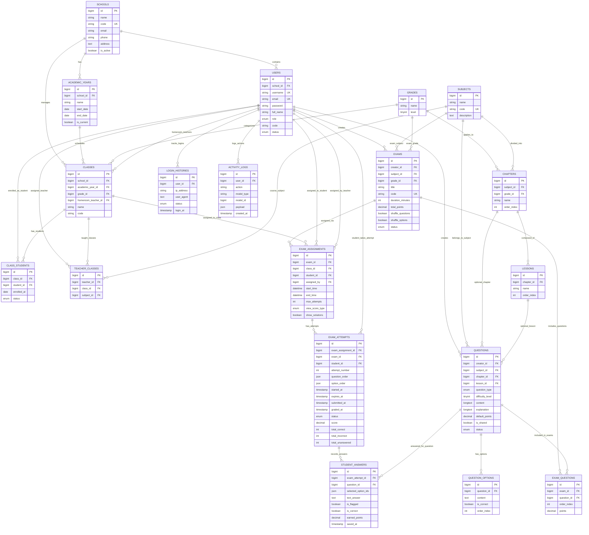

# SƠ ĐỒ THỰC THỂ QUAN HỆ (ENTITY RELATIONSHIP DIAGRAM - ERD)
## ONLINE EXAMINATION & LMS PLATFORM

---

## 1. SƠ ĐỒ MERMAID ERD

---

## 2. GIẢI THÍCH CÁC MỐI QUAN HỆ CỐT LÕI

1. **Khối - Lớp - Học sinh (School Hierarchy):**
   - Một trường học (`schools`) có nhiều năm học (`academic_years`) và nhiều lớp học (`classes`).
   - Quan hệ `class_students` phân tách rõ ràng việc học sinh gia nhập lớp, cho phép theo dõi lịch sử chuyển lớp mà không làm mất liên kết kết quả thi trong quá khứ.
2. **Cây kiến thức môn học (Subject Knowledge Tree):**
   - `subjects` (1) ---> (N) `chapters` (1) ---> (N) `lessons`.
   - Giúp giáo viên phân loại câu hỏi chi tiết tới từng bài học, hỗ trợ thuật toán trích xuất đề thi theo ma trận phân bổ kiến thức chính xác.
3. **Mối quan hệ Ngân hàng Câu hỏi - Đề thi (Question Bank to Exam):**
   - Đề thi (`exams`) liên kết với Câu hỏi (`questions`) thông qua bảng trung gian `exam_questions`.
   - Bảng `exam_questions` lưu trữ `order_index` (thứ tự trong đề gốc) và `points` (điểm số riêng biệt của câu hỏi trong đề thi này), cho phép một câu hỏi được tái sử dụng ở nhiều đề với thang điểm khác nhau.
4. **Mối quan hệ Đề thi - Giao bài - Lượt thi (Exam - Assignment - Attempt):**
   - Một đề thi có thể được giao nhiều lần cho nhiều lớp khác nhau (`exam_assignments`).
   - Mỗi lần giao có khung giờ thi (`start_time`, `end_time`) và chính sách riêng (`max_attempts`, `view_score_type`, `show_solutions`).
   - Khi học sinh làm bài, một bản ghi `exam_attempts` được tạo ra gắn với `exam_assignments` tương ứng.
5. **Cơ chế Snapshot thứ tự ngẫu nhiên (Shuffling Snapshot):**
   - Cột `question_order` và `option_order` (kiểu JSON) trong `exam_attempts` lưu lại chính xác thứ tự câu hỏi và phương án mà thí sinh nhìn thấy.
   - Nhờ vậy, ngay cả khi làm mới trang hoặc giáo viên xem lại bài thi của học sinh, thứ tự hiển thị vẫn nhất quán 100% với lúc làm bài.
6. **Lưu vết câu trả lời độc lập (Answer Persistence):**
   - Mỗi câu trả lời của thí sinh được lưu vào một dòng trong bảng `student_answers` với khóa duy nhất `uq_attempt_question (exam_attempt_id, question_id)`.
   - Thiết kế này tối ưu cho thao tác `UPSERT` tần suất cao khi học sinh click đổi đáp án liên tục trong quá trình làm bài.
